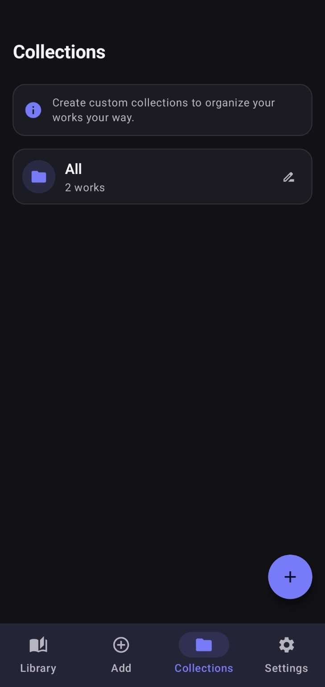

<div align="center">


# Seoga

**Your personal manga & comics bookshelf.**

An offline-first Android app to catalog manga, manhwa, manhua, and comics. Organize your collection, track reading progress, and keep your library on your device.

<p>
  
  
  <a href="LICENSE"></a>
</p>

<a href="https://github.com/joa-no/Seoga/releases/download/v1.0.1/Seoga-1.0.1.apk">
  
</a>
&nbsp;
<a href="https://github.com/joa-no/Seoga/releases/tag/v1.0.1">
  
</a>

<p>
  <a href="#screenshots">Screenshots</a> ·
  <a href="#features">Features</a> ·
  <a href="#installation">Installation</a> ·
  <a href="#build-from-source">Build from source</a>
</p>

</div>

---

## Screenshots

<table>
  <tr>
    <td align="center"></td>
    <td align="center"></td>
  </tr>
  <tr>
    <td align="center"><strong>My Library</strong></td>
    <td align="center"><strong>Online Search</strong></td>
  </tr>
  <tr>
    <td align="center"></td>
    <td align="center"></td>
  </tr>
  <tr>
    <td align="center"><strong>Collections</strong></td>
    <td align="center"><strong>Settings</strong></td>
  </tr>
</table>

## About Seoga

**Seoga** is a personal Android library for organizing manga, manhwa, manhua, and comics. Save titles with cover art and metadata, keep track of chapters, rate your favorite works, and create collections that match how you read.

The app is designed to work **offline without an account**. You can add entries manually, or optionally search for metadata using MangaDex and AniList.

> [!IMPORTANT]
> **Seoga is a catalog, not a reader.** It does not download or display manga or comic pages.

## Features

- **Personal library:** Catalog your works with titles, covers, and metadata.
- **Reading progress:** Keep track of chapters and rate titles using decimal scores.
- **Custom collections:** Put a work in more than one collection. The default collection includes all entries; it can be renamed but not deleted.
- **Bulk management:** Organize or remove multiple entries at once.
- **Online discovery:** Search optional metadata sources, including MangaDex and AniList.
- **Manual entries:** Add works without using an online service.
- **Content controls:** Optional adult-content search and 18+ indicators on covers.
- **Backup and restore:** Export and import your library using ZIP backups.
- **Multilingual UI:** English, Brazilian Portuguese, and Spanish.
- **Local-first:** Keep your library on your device, with no account required.

## Installation

1. Download the [**Seoga v1.0.1 APK**](https://github.com/joa-no/Seoga/releases/download/v1.0.1/Seoga-1.0.1.apk) from the [official release](https://github.com/joa-no/Seoga/releases/tag/v1.0.1).
2. Open the downloaded APK on your Android phone or tablet.
3. If Android prompts you, allow installation from your browser or file manager, then follow the on-screen instructions.

> [!NOTE]
> Only install APKs from sources you trust. The link above points to the release published in this repository.

## Requirements

- **Android 7.0 or newer** (API level 24+).
- **Internet connection:** Only needed for optional online metadata search; the local catalog works offline.
- **Account:** Not required.

## Backup & privacy

Your catalog is stored **locally on your device**. Use **Export ZIP** in Settings to create a backup for safekeeping or to move your library to another device; you can import it using **Restore**.

Online metadata searches contact the selected metadata provider. Seoga does not require a sign-in to manage your collection.

## Built with

| Component | Technology |
|:--|:--|
| Language | Kotlin |
| Interface | Jetpack Compose + Material 3 |
| Architecture | MVVM |
| Local storage | Room (SQLite) |
| Optional metadata | MangaDex + AniList |

## Build from source

Clone the repository and open it in Android Studio with a compatible Android SDK and JDK (Java 17 or newer).

Alternatively, build the Android debug variant using the included Gradle Wrapper:

```bash
./gradlew assembleDebug
```

On Windows, run `gradlew.bat assembleDebug`.

**Signing:** The project's debug build configuration expects a local `debug.keystore` at the repository root (alias `androiddebugkey`, store and key passwords `android`). This file is excluded from version control, so provide your own key when building locally.

For release history, see the [changelog](CHANGELOG.md).

## License & credits

Seoga is distributed under the [MIT License](LICENSE). Please retain the license and copyright notice when redistributing or modifying the source.

The name **Seoga** comes from the Korean word **서가**, meaning *bookshelf*.

---

<div align="center">

**Seoga — your library, your way.**

<sub>Created by <a href="https://github.com/joa-no">joa-no</a> · <a href="https://github.com/joa-no/Seoga/releases">Releases</a> · <a href="LICENSE">MIT License</a></sub>

</div>
