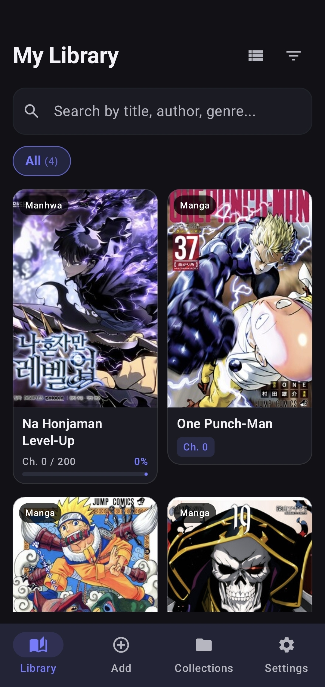
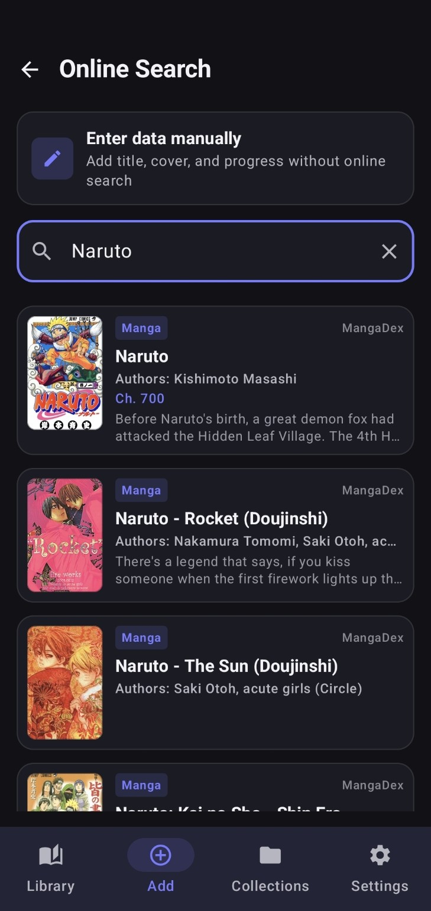
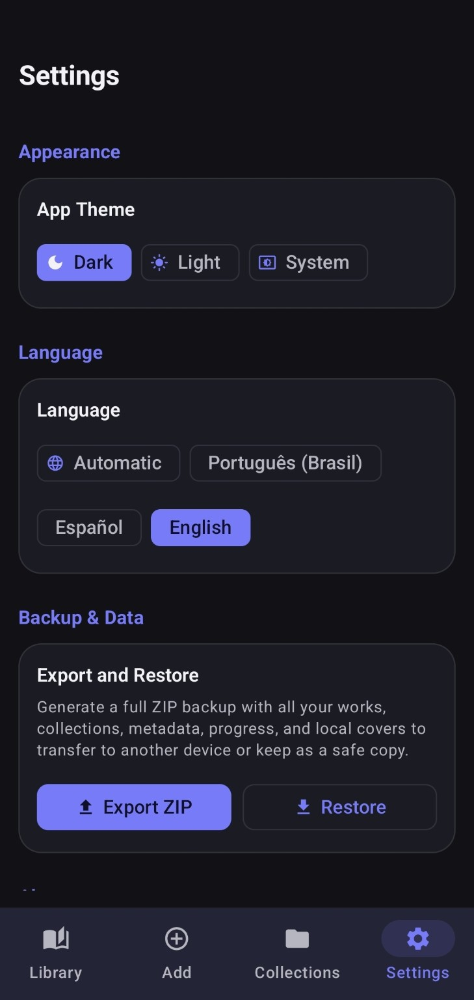

<div align="center">


# Seoga

**Your personal manga and comics library, organized your way.**

An offline-first Android catalog for manga, manhwa, manhua, and comics. Track chapters, rate your favorites, and organize your collection — without an account.

[**Download Seoga for Android (APK)**](https://github.com/joa-no/Seoga/releases/download/v1.0/Seoga.apk) · [v1.0 release](https://github.com/joa-no/Seoga/releases/tag/v1.0)

[Features](#features) · [Screenshots](#screenshots) · [Installation](#installation) · [Building](#building-from-source) · [Release notes](CHANGELOG.md)

</div>

> [!IMPORTANT]
> **Seoga is a catalog, not a reader.** It does not download or display manga or comic pages.

## Features

- **Personal library:** Catalog manga, manhwa, manhua, and comics with covers and metadata.
- **Reading progress:** Track chapters and assign decimal ratings.
- **Custom collections:** Organize titles into multiple collections. The default collection includes every work and can be renamed, but not deleted.
- **Bulk management:** Select multiple titles to manage collections or delete entries.
- **Optional online discovery:** Look up metadata through MangaDex and AniList, or add entries manually.
- **Content controls:** Optional adult-content search with 18+ cover labels.
- **Local-first:** Your library is stored on your device, with no account required. Online metadata search requires an internet connection.
- **Portable backups:** Export and restore your library using ZIP archives.
- **Languages:** English, Brazilian Portuguese, and Spanish.

## Screenshots

The screenshots below show the Android interface in dark mode.

| Library | Online search |
|:---:|:---:|
|  |  |
| **Collections** | **Settings** |
|  |  |

## Technology

- **Language:** Kotlin
- **UI:** Jetpack Compose and Material 3
- **Architecture:** MVVM
- **Local database:** Room (SQLite)
- **Metadata providers:** MangaDex and AniList

## Installation

**Android 7.0 or later** (API level 24+).

1. [Download the Seoga v1.0 APK](https://github.com/joa-no/Seoga/releases/download/v1.0/Seoga.apk) from the [official GitHub release](https://github.com/joa-no/Seoga/releases/tag/v1.0).
2. Open the downloaded APK on your Android device.
3. If prompted, allow installation from your browser or file manager, then complete the on-screen installation steps. Only install APKs from sources you trust.

No sign-in is required. You can add works manually without an internet connection; metadata search requires internet access.

## Building from source

Open the project in Android Studio with a compatible Android SDK and JDK (Java 17 or newer). Alternatively, use the included Gradle Wrapper:

```bash
./gradlew assembleDebug
```

On Windows, use `gradlew.bat assembleDebug` instead. The wrapper downloads the project's configured Gradle version automatically.

**Debug signing note:** The current project configuration expects a local `debug.keystore` at the repository root (alias `androiddebugkey`, store/key passwords `android`). This file is deliberately excluded from version control, so you must provide your own debug key when building locally.

## Release notes

See the [v1.0 changelog](CHANGELOG.md) and the [release page](https://github.com/joa-no/Seoga/releases/tag/v1.0).

## Privacy and data

Seoga keeps your catalog data on your device. Online metadata lookup is optional and requires network access to the selected provider. Use the ZIP export feature to create a backup before switching devices or uninstalling the app.

## Name

**Seoga** comes from the Korean word **서가**, meaning *bookshelf*.

## License

Distributed under the [MIT License](LICENSE). See the license file for terms and attribution.

---

<div align="center">
Made by <a href="https://github.com/joa-no">joa-no</a>
</div>
